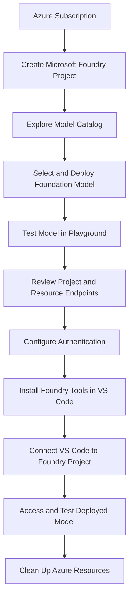
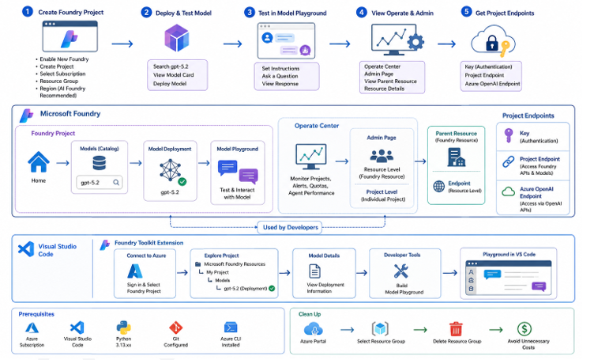

# Azure AI Development Project with Microsoft Foundry

This repository documents a hands-on lab for setting up and exploring a cloud-based AI development environment with **Microsoft Foundry**. It covers project creation, foundation-model discovery and deployment, prompt testing, endpoint configuration, and integration with Visual Studio Code.

## Table of Contents

- [Project Overview](#project-overview)
- [Project Objectives](#project-objectives)
- [Architecture and Workflow](#architecture-and-workflow)
- [Technology Stack](#technology-stack)
- [Implementation Steps](#implementation-steps)
- [Key Technical Concepts](#key-technical-concepts)
- [Responsible AI and Security](#responsible-ai-and-security)
- [Key Takeaways](#key-takeaways)
- [Future Learning](#future-learning)
- [Project Screenshots](#project-screenshots)
- [About This Project](#about-this-project)
- [Connect and Collaborate](#connect-and-collaborate)

## Project Overview

The lab demonstrates how to create and configure a Microsoft Foundry project, explore the model catalog, deploy a foundation model, experiment with prompts in the Model Playground, review project and resource endpoints, and connect the environment to Visual Studio Code.

The goal is to understand the initial stages of the Generative AI application-development lifecycle and the tools used to build and manage AI-powered solutions in Azure.

## Project Objectives

- Understand Microsoft Foundry and its role in Generative AI development.
- Create and configure an AI development project.
- Explore the available foundation models in the model catalog.
- Deploy and test a selected model.
- Experiment with prompts using the Model Playground.
- Understand project-level and resource-level endpoints.
- Explore authentication and API configuration.
- Connect Microsoft Foundry to Visual Studio Code.
- Understand the importance of responsible AI and security controls.

## Architecture and Workflow

The following diagram summarizes the workflow covered by this lab.



## Technology Stack

| Technology | Purpose |
|---|---|
| Microsoft Azure | Cloud infrastructure and resource management |
| Microsoft Foundry | Environment for developing Generative AI applications |
| Foundation model deployment | Makes a selected model available for testing and application use |
| Model Catalog | Discover and compare available models |
| Model Playground | Experiment with prompts and model responses |
| Visual Studio Code | Local development environment |
| Microsoft Foundry tools for VS Code | Connect the IDE to Foundry resources |
| Azure authentication | Authenticate access to Azure resources |

> **Model note:** The original lab notes refer to GPT-5.5. Model availability and naming can change by region, subscription, and time. Confirm the exact model name shown in your Foundry Model Catalog before following the deployment steps. This README therefore uses “selected foundation model” in general workflow descriptions.

## Implementation Steps

### 1. Create a Microsoft Foundry Project

- Open the Microsoft Foundry portal.
- Create a new Foundry project.
- Select the required Azure subscription and configure the project resources.
- Review the project workspace and its available settings.

**Key learning:** Understand how Foundry organizes AI development resources within a project environment.

### 2. Explore the Model Catalog

- Open the Model Catalog.
- Browse the available foundation models.
- Review model descriptions, availability, and deployment options.
- Select a model that is available for your subscription and region.

**Key learning:** Understand model discovery and selection as part of the AI development lifecycle.

### 3. Deploy a Foundation Model

- Select the chosen model from the catalog.
- Review the deployment options and configuration.
- Deploy the model, subject to the availability and quota of your Azure subscription.
- Review the deployment details after it is ready.

**Key learning:** Understand how a foundation model is deployed and made available for use.

### 4. Test the Model in the Model Playground

- Open the Model Playground for the deployment.
- Enter system instructions and prompts.
- Submit sample prompts.
- Review the generated responses and experiment with prompt changes.

**Key learning:** Explore model behavior and prompt design before integrating a model into application code.

### 5. Review Project and Resource Endpoints

Review the endpoint information provided by Foundry for application integration. Depending on the resource and deployment type, this can include:

- Project-level endpoints.
- Resource-level endpoints.
- Authentication requirements, such as Microsoft Entra ID or API keys where supported.
- Model deployment names and API configuration.

**Key learning:** Understand how applications connect to deployed models and why endpoint and authentication configuration matter. Keep API keys and other credentials out of source control.

### 6. Connect Microsoft Foundry to Visual Studio Code

- Open Visual Studio Code.
- Install the Microsoft Foundry extension or toolkit used in the lab.
- Sign in with the appropriate Azure account.
- Connect to the relevant Foundry project.
- Locate the deployed model and use the available development or playground features to test it.

**Key learning:** Understand how developers can work with Foundry resources from an IDE.

### 7. Clean Up Azure Resources

- Confirm that the lab exercises are complete.
- Identify the Azure resource group and resources created specifically for the lab.
- Delete only the resources that are no longer required.
- Verify the cleanup in the Azure portal.

**Key learning:** Clean up unused cloud resources to avoid unintended ongoing charges. Make sure the resource group does not contain resources needed by other projects before deleting it.

## Key Technical Concepts

| Concept | What it means |
|---|---|
| Microsoft Foundry | Azure environment for building and managing Generative AI applications |
| Foundation models | Pre-trained models that can be used as the basis for AI applications |
| Model catalog | The place to discover available models and deployment options |
| Model deployment | Making a model available through a configured deployment |
| Model Playground | Interface for trying prompts and reviewing model responses |
| Prompt engineering | Designing instructions and inputs to guide model responses |
| Project endpoints | Endpoints associated with a Foundry project |
| Resource endpoints | Endpoints associated with the underlying Azure AI resource |
| Azure authentication | Controlling and verifying access to Azure resources |
| IDE integration | Working with Foundry resources from a development environment |
| Responsible AI | Practices and controls that help make AI systems safer and more trustworthy |

## Responsible AI and Security

Responsible AI and security should be considered throughout the development lifecycle. Areas to review in Microsoft Foundry and the associated Azure services include:

- Safety evaluations and model testing.
- Content filtering and related safety configurations.
- Identity, authentication, and access management.
- Secure handling of endpoints, API keys, and other credentials.
- Monitoring and evaluation appropriate to the application.

The exact controls available depend on the model, service, and resource configuration.

## Key Takeaways

This hands-on lab helped build an understanding of the early stages of the Generative AI development lifecycle:

1. Creating a centralized AI development environment with Microsoft Foundry.
2. Discovering and deploying foundation models.
3. Experimenting with prompts in the Model Playground.
4. Understanding project and resource endpoints.
5. Connecting Foundry resources to Visual Studio Code.
6. Recognizing the importance of responsible AI, security, and cloud-resource cleanup.

## Future Learning

Potential next steps include:

- Building an end-to-end Generative AI application.
- Practicing advanced prompt-engineering techniques.
- Integrating foundation models into Python applications.
- Exploring Retrieval-Augmented Generation (RAG).
- Building AI-powered applications with Microsoft Foundry.
- Learning application evaluation, security, monitoring, and deployment workflows.

## Project Screenshots

Add your own lab screenshots to an `images/` folder in this repository. Once the images have been committed, you can display them using Markdown image links, for example:

```markdown

```

Suggested screenshots:

| Suggested file | Description |
|---|---|
| `images/foundry-project.png` | Microsoft Foundry project dashboard |
| `images/model-catalog.png` | Model Catalog and model selection |
| `images/model-deployment.png` | Foundation-model deployment |
| `images/model-playground.png` | Model Playground and prompt testing |
| `images/foundry-endpoints.png` | Project and resource endpoint details |
| `images/vscode-integration.png` | Foundry integration in Visual Studio Code |
| `images/vscode-model-test.png` | Model testing from Visual Studio Code |

*The filenames above are suggestions. Add the image files before using them as rendered image links.*

## About This Project

- **Role:** AI/ML Engineer (learning project)
- **Project type:** Hands-on cloud AI / Generative AI lab
- **Platform:** Microsoft Azure – Microsoft Foundry
- **Focus areas:** Generative AI, foundation models, model deployment, prompt engineering, cloud AI, and development workflows

This project is part of my ongoing learning journey in AI/ML engineering, with an emphasis on practical skills in Generative AI and enterprise AI development.

## Connect and Collaborate

I am continuing to explore AI technologies and build practical AI/ML projects. I welcome opportunities to connect with AI/ML engineers, Generative AI developers, cloud architects, recruiters, and other technology professionals.

If you find this project useful, please consider giving the repository a star.

---

**Topics:** Microsoft Foundry · Generative AI · Microsoft Azure · AI Engineering · Machine Learning · Cloud AI · Visual Studio Code · Responsible AI
